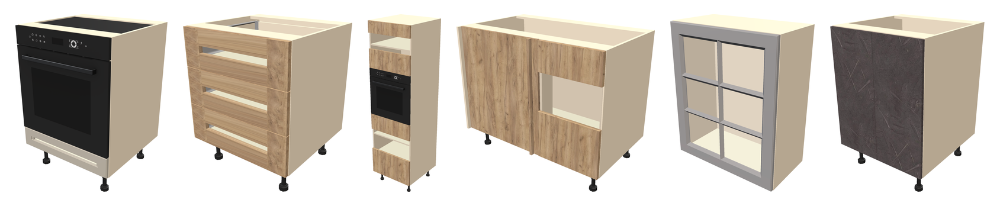
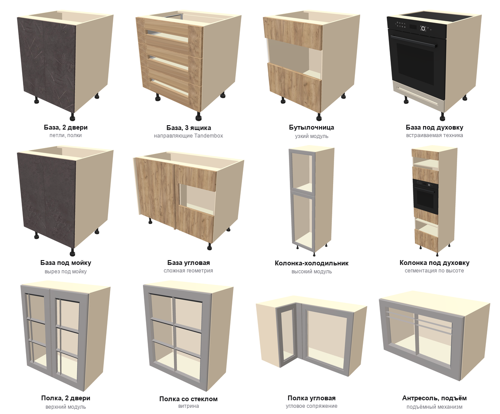
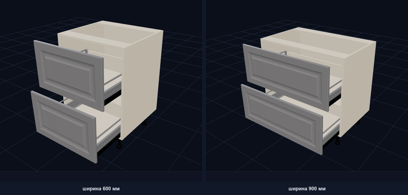
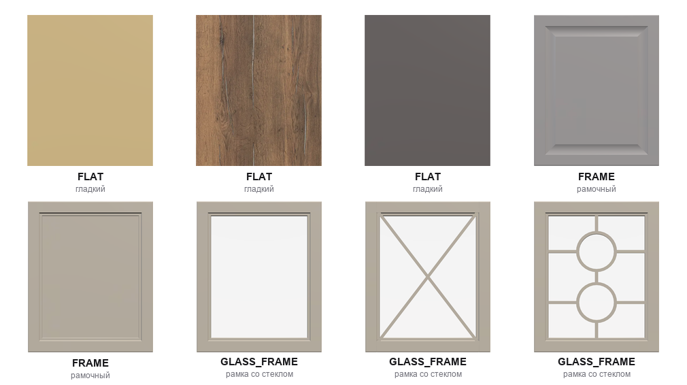
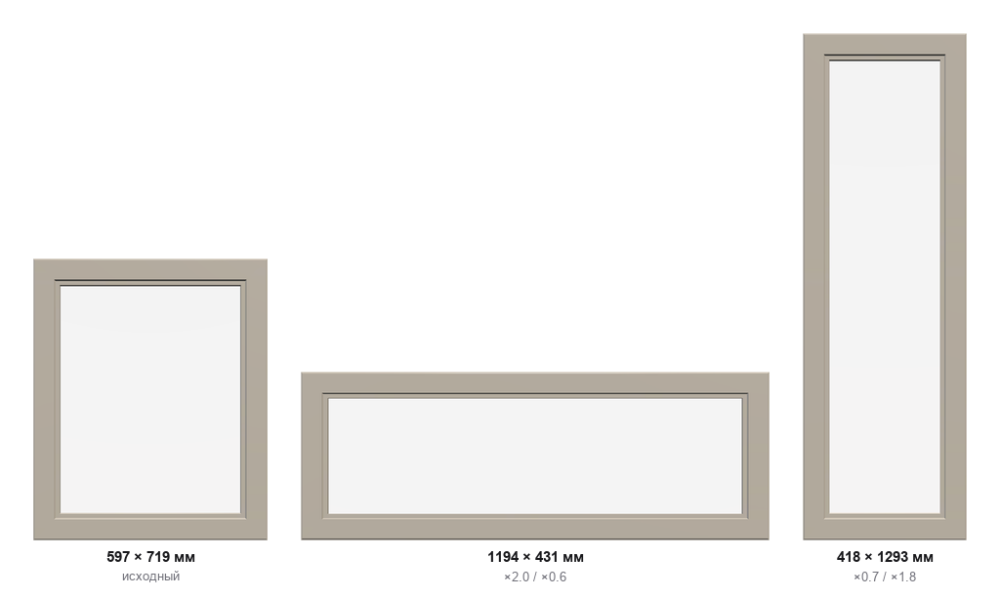
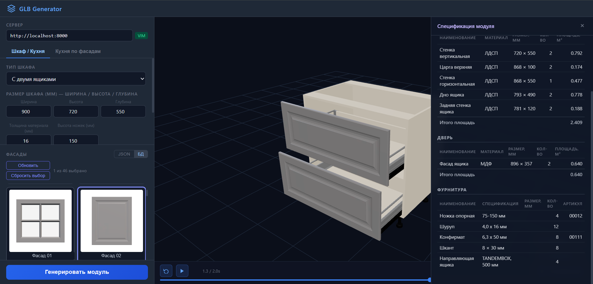
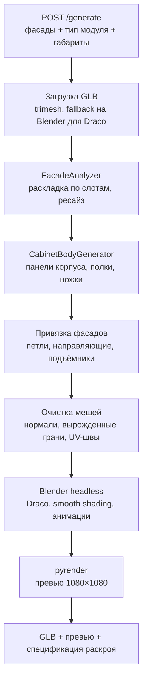

# GLB Generator — параметрическая генерация 3D-моделей кухонной мебели

Бэкенд-сервис, который собирает готовую 3D-модель кухонного модуля из фасада и набора размеров.
На вход — GLB-файл фасада, тип модуля и габариты в миллиметрах. На выходе — корпус с фурнитурой,
текстурами, анимациями открывания, превью-рендерами и спецификацией раскроя для производства.

> Коммерческий проект для мебельного ритейла. Исходный код закрыт — здесь показаны результаты
> работы сервиса и архитектурные решения. Все рендеры получены прогоном реального кода.

---

## Зачем это нужно

Мебельный конфигуратор должен показывать покупателю его кухню в 3D. Проблема в том, что
комбинаций слишком много: десятки типов модулей × сотни размеров × каталог фасадов.
Моделировать каждую вручную невозможно.

Сервис решает это иначе: дизайнер готовит **только фасад**, всё остальное собирается кодом.
Корпус, полки, петли, направляющие, ножки, встраиваемая техника и анимации рассчитываются
из габаритов и правил мебельного производства.

---

## Что умеет

### 45 типов модулей

Базы, колонки, навесные полки, антресоли, угловые модули, модули под технику.
32 базовых типа + 10 зеркальных + 3 служебных для угловых сопряжений.

Для каждого типа прототип задаёт схему расположения фасадов, набор панелей корпуса,
позиции фурнитуры и правила сегментации по высоте.

### Один модуль — любые размеры

Один и тот же тип модуля и один и тот же фасад при ширине 600 и 900 мм. Меняется только
число в поле формы — корпус, фасады, направляющие и позиции ножек пересчитываются сами.
Анимация открывания собирается вместе с геометрией: у ящиков это выдвижение по
направляющим, у дверей — поворот вокруг петли, у антресолей — подъём.

🔎 **[Посмотреть готовую модель в браузере](assets/example_module.glb)** — GitHub показывает
GLB интерактивно: можно покрутить и рассмотреть структуру. Внутри всё, что генерирует
сервис: панели корпуса, фасады, направляющие Tandembox, ножки, анимация и Draco-сжатие.

### Анализ и классификация фасадов

Загруженный GLB разбирается геометрически: габарит, профиль глубины, число уровней по Z,
количество материалов, наличие прозрачности, толщина бортика. По этим признакам
rule-based классификатор определяет тип поверхности — от этого зависит,
как фасад можно масштабировать.

Подписи на изображении — фактический вывод классификатора, а не ручная разметка.
На каталоге из 46 фасадов валидация и классификация отрабатывают без ошибок;
полный цикл «разбор + классификация + три превью-рендера» занимает около 2 секунд на фасад.

### Ресайз с сохранением декора

Фасад из каталога почти никогда не совпадает по размеру со слотом в корпусе. Наивное
масштабирование ломает пропорции: рамка раздувается вместе с полотном.

Для рамочных фасадов применяется **9-slice**: углы сохраняются как есть, стороны тянутся
по одной оси, центр — по обеим. Толщина рамки остаётся постоянной при любом размере.

Один и тот же исходный фасад, растянутый вдвое по ширине и вдвое по высоте — толщина рамки
не изменилась. Всего реализовано 5 стратегий масштабирования, выбор зависит от типа поверхности.

### Спецификация для производства

Модель — это только половина задачи. Вторая половина в том, что модуль нужно изготовить,
поэтому вместе с геометрией сервис отдаёт спецификацию раскроя и фурнитуры.

Спецификация делится на четыре раздела — под разные потоки раскроя: ЛДСП корпуса,
задняя стенка, МДФ фасадов и фурнитура. Панели описаны размером, количеством и площадью,
фурнитура — типоразмером и артикулом из внешней БД.

Логика, которая уже применена на стороне генератора:

- **Дедупликация.** Одинаковые детали схлопнуты в одну строку с суммарным количеством:
  панели по ключу «имя + материал + длина + ширина», фурнитура — «имя + типоразмер».
- **Сопутствующий крепёж развёрнут.** Если у петли в БД прописаны 4 шурупа, они попадают
  отдельной строкой, а шурупы от петель и газлифтов суммируются в одну позицию.
- **Имена деталей совпадают с именами нод в GLB-сцене** — строка спецификации однозначно
  сопоставляется с элементом 3D-модели.

Скриншоты сняты с интерфейса, который я написал для ручного тестирования пайплайна:
выбор типа модуля, размеры, каталог фасадов, проигрывание анимации и просмотр спецификации.

---

## Как устроено

Два режима работы:

- **Одиночный модуль** — `POST /generate`, собирает один шкаф по явным параметрам.
- **Детерминированная кухня** — `POST /generate-determine-kitchen`, пакетная генерация
  всего набора модулей по каталогу фасадов и списку типоразмеров. Результат воспроизводим:
  одинаковый вход всегда даёт одинаковый набор моделей. Подбор фасада под слот — поиск
  ближайшего по евклидову расстоянию в пространстве «ширина × высота».

Отдельный эндпоинт `POST /validate` принимает GLB от дизайнера и возвращает размеры,
классификацию и превью — это входной контроль каталога.

---

## Инженерные решения, которыми доволен

**Blender как headless-инструмент в пайплайне.** trimesh не умеет ни Draco-сжатие, ни
анимации, ни корректный smooth shading. Blender запускается подпроцессом со скриптом,
делает эти три вещи и отдаёт файл. Он же работает запасным загрузчиком, когда входной
GLB пришёл уже сжатым Draco и trimesh его не берёт.

**Каталог ошибок с числовыми кодами.** Все три эндпоинта отдают HTTP 400 с единой
структурой: человекочитаемое сообщение, полный traceback и код из enum. Фронтенд
реагирует на код, разработчик смотрит traceback, пользователь видит сообщение.

**Пакетная генерация не падает целиком.** В детерминированной кухне неудачный модуль
логируется и пропускается — остальной батч доезжает до конца.

**UV-маппинг с равномерной плотностью.** Текстура древесины должна выглядеть одинаково
на дверце 400 мм и на дверце 800 мм, иначе в собранной кухне видно расхождение масштаба.

**Единая схема именования деталей.** Ноды в GLB и строки спецификации называются
одинаково. Благодаря этому 3D-модель и производственный документ остаются связаны:
по строке раскроя видно, какой именно элемент сцены она описывает.

---

## Стек

| | |
|---|---|
| Язык, API | Python 3.12, FastAPI, Pydantic, Uvicorn |
| 3D | trimesh, pygltflib, numpy, scipy |
| Рендер | pyrender, PyOpenGL, Pillow |
| Экспорт | Blender 5.0 headless, Draco |
| Инфраструктура | Docker, Poetry, S3 (boto3) |

---

## Цифры

| | |
|---|---|
| Кода | ~9 400 строк Python в 49 модулях |
| Типов модулей | 45 |
| Типов поверхности фасада | 8 |
| Стратегий ресайза | 5 |
| Коммитов | 120 за февраль — сентябрь 2026 |
| Моя роль | основной разработчик, 112 из 120 коммитов |

Архитектура, 3D-пайплайн, интеграция Blender, классификация и ресайз фасадов,
режим детерминированной кухни, контейнеризация — моя зона ответственности.

---

## Контакты

Готов рассказать подробнее про любую часть пайплайна — и показать код на собеседовании.

- GitHub: [@OlegShir](https://github.com/OlegShir)
- Почта: olegshir3d@gmail.com
- Telegram: _добавить_
